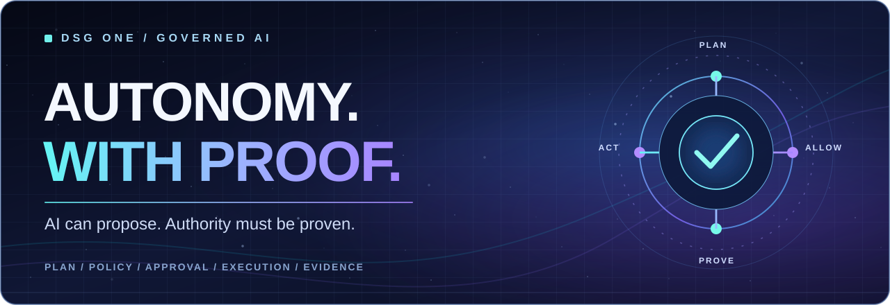
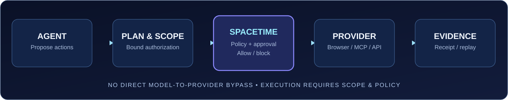

<!-- DSG ONE public GitHub profile. Scope-limited claims; current status belongs to dated evidence. -->
<div align="center">
  

  <h1>Thanawat Suparongsuwan</h1>
  <p><strong>Founder &amp; Systems Builder — DSG ONE</strong></p>
  <p>Building the execution boundary for AI agents that need to act on real systems — with authorization, policy, human approval, and verifiable evidence.</p>

  <p>
    <a href="https://dsg.pics"><strong>Explore DSG ONE ↗</strong></a>
    &nbsp;·&nbsp;
    <a href="https://github.com/tdealer01-crypto/DSG-Spacetime-Source"><strong>Explore Spacetime ↗</strong></a>
    &nbsp;·&nbsp;
    <a href="https://github.com/tdealer01-crypto?tab=repositories"><strong>Public repositories ↗</strong></a>
  </p>
  <p>
    
    
    
  </p>
</div>

---

### Latest public evidence — 30 October 2026 release

**Verified publication/archive, not independently reproduced public Production E2E.** The public evidence package is DSG Spacetime **v1.2.0**, published on **30 October 2026**. This is the latest publication verified in the linked public records as checked on **1 November 2026**; this check does **not** represent a new Production execution on 1 November.

**[OPEN PUBLIC EVIDENCE (TH/EN)](https://dsg-public-evidence.shipstatic.com/)** · **[EVIDENCE STATUS AND SCOPE](docs/EVIDENCE_STATUS_20261101.md)** · **[Machine-readable evidence](https://dsg-public-evidence.shipstatic.com/evidence.json)**

| Open and verify | What it proves |
|:--|:--|
| **[Zenodo v1.2.0 / DOI 10.5281/zenodo.23796173](https://zenodo.org/records/23796173)** | Citable dated public archive |
| **[GitHub release v1.2.0](https://github.com/tdealer01-crypto/doi/releases/tag/v1.2.0)** | Exact public release |
| **[Release integrity / 24-file verification](https://github.com/tdealer01-crypto/doi/blob/main/docs/VERIFY_RELEASE_V1_2_0.md)** | Reproduce archive checksum and signed-commit API checks |
| **[Production evidence and limitations](https://github.com/tdealer01-crypto/doi/blob/v1.2.0/docs/DSG_NVIDIA_PRODUCTION_PUBLIC_PROOF_20261030.md)** | Scoped read-only NVIDIA Workroom/browser/Memory acceptance; private-primary-record limitations |
| **[Public reproduction protocol](https://github.com/tdealer01-crypto/doi/blob/main/docs/PUBLIC_REPRODUCTION_PROTOCOL_20261030.md)** | Which checks are public, access-restricted, or still unverified |
| **[Publication status](https://github.com/tdealer01-crypto/doi/blob/main/PUBLICATION_STATUS.md)** | Release commit, SHA-256, archive ingestion and date |

**Truth boundary:** the specified NVIDIA Nemotron API read-only Workroom/browser/Memory slice is documented against a pinned source and serving-image digest. Original production execution records and the Ed25519 CI payload remain private. No independent public Production E2E replay, arbitrary device execution, or current universal agent success is claimed. More recent development activity is **not** automatically a new public evidence release.

### See an actual demo and try a verified tag

[](https://github.com/tdealer01-crypto/dsg-gate-demo-nextjs)

**[View the real GitHub Actions demo repository](https://github.com/tdealer01-crypto/dsg-gate-demo-nextjs)** · **[Verified Execution Gate documentation](https://github.com/tdealer01-crypto/dsg-secure-deploy-gate-action)**

The image is an existing GitHub Actions demo screenshot, **not** a new live Production E2E recording. A verified 10-second Production GIF is **not published**; one should only be added after a real capture has been reviewed and sanitized.

**Quick Start (GitHub Actions, v1 readiness check):** create `.github/workflows/dsg-readiness.yml` in a GitHub repository and replace `https://your-app.example/health` with your real HTTP 200 readiness URL:

```yaml
name: DSG readiness evidence
on: [workflow_dispatch]
permissions:
  contents: read
jobs:
  dsg-check:
    runs-on: ubuntu-latest
    steps:
      - name: Check readiness with DSG
        uses: tdealer01-crypto/dsg-secure-deploy-gate-action@v1.1.0
        with:
          preset: basic
          readiness_url: https://your-app.example/health
          require_json_ok: 'false'
      - name: Show evidence artifact
        if: always()
        uses: actions/upload-artifact@v4
        with:
          name: dsg-readiness-evidence
          path: dsg-evidence.json
```

**Where to see the result:** GitHub repository → **Actions** → **DSG readiness evidence** → **Run workflow** → job result / `dsg-readiness-evidence` artifact. This tests **readiness**, not full governed execution. The `v1.1.0` Action tag and its input contract were checked against the real repository; do not substitute undocumented CLI commands or an unverified release tag.

### The idea

> **Powerful agents should be able to do real work. Their permission to act should never be invented by the model.**

DSG ONE is a governed AI execution platform built around a practical separation: **models reason; authorization governs; providers execute; evidence records what happened.** The aim is autonomous work within an owner-approved plan, not a pile of confirmation dialogs and not an agent with unrestricted tool access.

### From a prompt to a provable action

<div align="center">
  
</div>

The decision belongs at the execution boundary. Within an approved scope, ordinary steps can proceed. If authority is missing or an action crosses its approved boundaries, the system must **stop rather than improvise permission**.

### Explore the DSG ecosystem

| Project | What it is |
|:--|:--|
| **[DSG Spacetime](https://github.com/tdealer01-crypto/DSG-Spacetime-Source)** | Public source for plan-bound authorization, governed tool routes, execution and tamper-evident evidence. |
| **[DSG OS + Cinema](https://github.com/tdealer01-crypto/DSG-Cinema-Proof-Agent)** | Governed browser and shared-screen execution work, with policy, approval and proof boundaries. |
| **[DSG ONE / App Builder](https://github.com/tdealer01-crypto/dsg-one-v1)** | Application and workflow surface for agents operating under governed plans. |
| **[Verified Execution Gate](https://github.com/tdealer01-crypto/dsg-secure-deploy-gate-action)** | GitHub Action for bounded execution decisions and proof receipts. |
| **[DSG Control Plane](https://github.com/tdealer01-crypto/tdealer01-crypto-dsg-control-plane)** | Public control-plane implementation and interface work. |

### Built for people who need more than a successful demo

<table>
  <tr>
    <td width="50%" valign="top"><strong>01 — Autonomy with a scope</strong><p>Let an agent carry out work inside the user's actual authority and the approved plan.</p></td>
    <td width="50%" valign="top"><strong>02 — An enforceable boundary</strong><p>Evaluate plan, principal, permissions, policy and required approvals before provider execution.</p></td>
  </tr>
  <tr>
    <td valign="top"><strong>03 — Evidence, not confidence</strong><p>Keep provider results, hashes and signed or replayable proof where the implementation supports them.</p></td>
    <td valign="top"><strong>04 — One understandable experience</strong><p>Make task state visible as <code>COMPLETED</code>, <code>WAITING_APPROVAL</code>, <code>BLOCKED</code> or <code>FAILED</code>.</p></td>
  </tr>
</table>

### Engineering DNA

```text
VERIFY     → inspect actual state and authoritative evidence
AUTHORIZE  → exact plan, real principal, correct scope
EXECUTE    → governed provider route; never a model bypass
PROVE      → record what the provider actually returned
RECOVER    → explain failure and the next valid action
```

**Areas of work:** agent orchestration · Model Context Protocol (MCP) · deterministic policy · Z3/SMT verification · cryptographic evidence · secure deployment · browser automation · TypeScript / Python · AWS.

### Trust is a testable property — not a badge

Public repositories contain implementation details and dated, scoped evidence. **A passing CI job, healthy service, signed read-only call or successful component test does not establish complete production E2E.** In particular, do not infer full approved browser connect/execute, device control, XR runtime acceptance or independent compliance certification from this profile.

For source-specific progress and limitations, review the linked repository documentation and associated run evidence. Private customer data, infrastructure secrets and proprietary runtime materials are not presented here.

---

<div align="center">

### The future is agentic. The execution must be accountable.

**[DSG ONE website](https://dsg.pics)** · **[Open-source work](https://github.com/tdealer01-crypto?tab=repositories)** · **[Spacetime architecture](https://github.com/tdealer01-crypto/DSG-Spacetime-Source)**

<sub>Built in Thailand · Designed for interoperable AI systems · Evidence before claims.</sub>

</div>

<details>
<summary><strong>ภาษาไทย — เกี่ยวกับ DSG ONE</strong></summary>

DSG ONE พัฒนาระบบกำกับการทำงานของ AI Agent เพื่อให้เอเจนต์ดำเนินงานจริงภายใต้สิทธิ์และขอบเขตที่เจ้าของอนุมัติไว้ โดยใช้ DSG Spacetime ตรวจนโยบายและการอนุมัติก่อนเข้าถึงเครื่องมือหรือผู้ให้บริการจริง และบันทึกหลักฐานผลการทำงาน

แนวคิดหลักคือ **ให้ AI คิดและเสนอแผนได้ แต่ไม่มีสิทธิ์สร้างอำนาจอนุมัติขึ้นมาเอง** งานที่มีสิทธิ์ให้ดำเนินต่อได้ งานที่เกินขอบเขตต้องหยุด พร้อมแจ้งเหตุผลและวิธีแก้ไข

ข้อมูลการทดสอบของแต่ละส่วนต้องพิจารณาตามหลักฐานและขอบเขตที่ระบุไว้ ไม่ใช้ผลทดสอบบางฟีเจอร์แทนการยืนยันว่าทั้งระบบผ่าน Production E2E

</details>